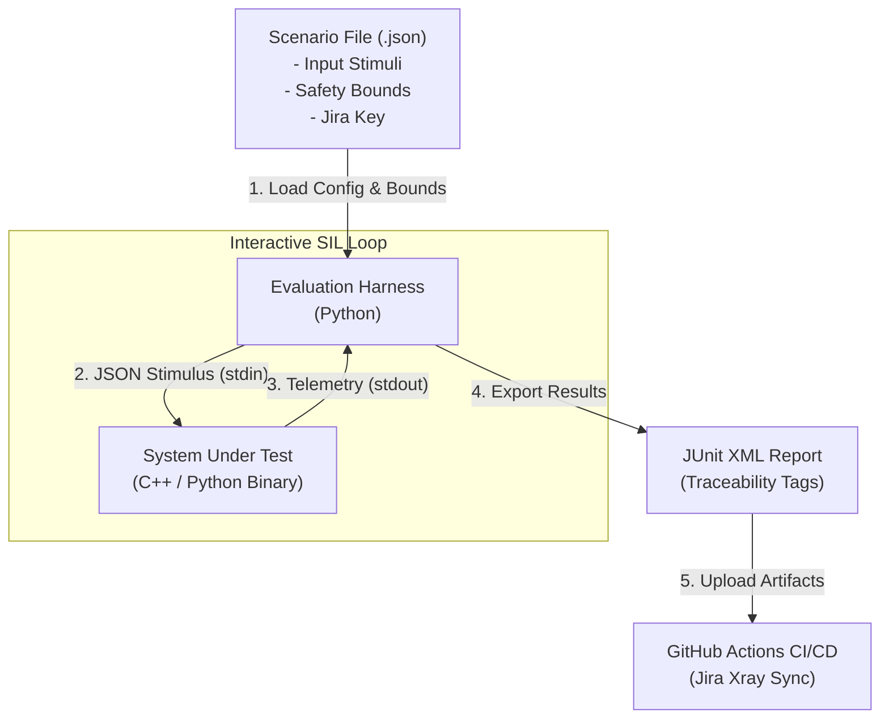

# SIL Telemetry Verification Harness
An automated, data-driven Software-in-the-Loop (SIL) Telemetry Verification Framework designed for safety-critical embedded systems (e.g., aerospace flight controllers, automotive ECUs, robotics).

This harness executes compiled control software binaries via interactive IPC pipes (stdin/stdout), evaluates physical state telemetry against defined safety boundaries across time-series scenarios, and automatically pushes JUnit XML test execution reports to Jira/Xray for regulatory compliance tracking (DO-178C / ISO 26262).
# Architecture & Data Flow

# Key Features
Data-Driven Test Scenarios: Define input stimulus sequences and physical safety bounds in decoupled JSON files without modifying the core harness or SUT binaries.

Interactive Closed-Loop Execution: Uses line-buffered non-blocking subprocess IPC pipes to feed real-time inputs into the SUT and capture state updates frame-by-frame.

Safety Bound Verification: Automatically evaluates time-series telemetry against minimum and maximum allowable physical thresholds (e.g., battery voltage, core temperature).

Automated Traceability (Jira/Xray): Emits standardized JUnit XML reports mapping test cases to specific Jira requirement keys (AERO-101) to support automated Requirement Traceability Matrix (RTM) generation.

Continuous Integration: Fully integrated with GitHub Actions to block non-compliant code merges on Pull Requests.
